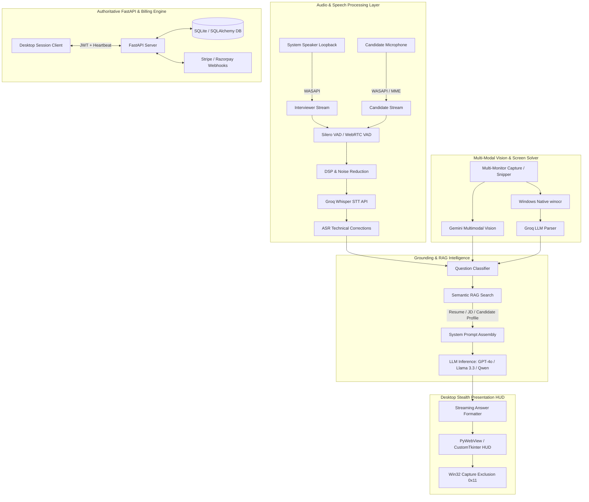

# ✦ BluJay AI — Live Interview Copilot & Smart Preparation Assistant

<div align="center">


**A Stealth, Real-Time, Multi-Modal Desktop AI Copilot for Technical & Behavioral Interviews**

[](https://www.python.org/)
[](https://fastapi.tiangolo.com/)
[](https://groq.com/)
[](https://www.microsoft.com/windows)
[](#)

</div>

---

## 📌 Overview

**BluJay AI** is an advanced desktop interview copilot and practice platform designed to assist software engineers, system architects, and tech candidates during live interviews and preparation sessions.

The system continuously transcribes both interviewer audio (system speaker loopback) and candidate speech (microphone), grounds context using the candidate's verified resume and job descriptions (RAG), captures screen coding challenges with multi-modal vision and hardware OCR, and streams structured, natural, personalized interview answers in real time.

---

## 🚀 Key Features & Capabilities

### 🛡️ 1. Stealth Mode & Anti-Screenshare Protection
* **OS-Level Capture Exclusion**: Utilizes Windows Win32 API `SetWindowDisplayAffinity(HWND, WDA_EXCLUDEFROMCAPTURE)` (`0x11`) to ensure all UI windows, popups, and HUD elements are completely invisible on screen shares (Zoom, Microsoft Teams, Google Meet, OBS, Discord, Webex).
* **HWND Recreation Watcher**: Continuously monitors process window handles to instantly reapply capture exclusion whenever child frames, search boxes, or dialogs are recreated.

### 🎙️ 2. High-Fidelity Dual-Stream Audio & STT Pipeline
* **Dual-Channel Audio Capture**:
  * **Interviewer Channel**: Low-latency WASAPI loopback (`soundcard`) capturing remote speaker voice directly from the soundcard.
  * **Candidate Channel**: Local microphone stream (`sounddevice`).
* **ML-Based Voice Activity Detection (Silero VAD)**: Runs ONNX-optimized Silero VAD on CPU (~1ms inference time) with WebRTC VAD fallback.
* **DSP Audio Processing**: Spectral noise reduction (`noisereduce`), DC-offset filtering, and Automatic Gain Control (AGC).
* **ASR Post-Processing**: Real-time phonetic and technical vocabulary correction dictionary (e.g., PostgreSQL, Kubernetes, FastAPI, PyTorch, O(N log N)).

### 👁️ 3. Multi-Modal Vision & Coding Problem Solver
* **Dual-Engine Vision**:
  * **Google Gemini Multimodal Vision**: Pixel-level comprehension of complex diagrams, LeetCode / HackerRank problem descriptions, and IDE code blocks.
  * **Windows Native OCR (`winocr`) + Groq LLMs**: Hardware-accelerated text extraction paired with Llama 3.3 70B / Qwen 2.5 27B.
* **Multi-Monitor Support**: Native enumeration of all physical monitors with interactive snipping tool (`Ctrl + Shift + Enter`).
* **Sandboxed Code Execution**: Local Python execution sandbox (`code_sandbox.py`) to run and verify code solutions against sample test cases in real-time.

### 🧠 4. Personalized RAG & Grounded Intelligence
* **Resume & JD Ingestion**: Supports `.pdf`, `.docx`, `.txt`, and `.md` candidate profiles.
* **TF-IDF & Cosine Similarity Engine**: Retrieves relevant project experiences and skills based on the question context.
* **Strict Hallucination Prevention**:
  * Explains general technical concepts objectively.
  * Answers candidate project questions strictly using verified candidate data in first-person voice (`"I built..."`). Never fabricates employment history or claims unverified implementations.

### ⚡ 5. Frosted Glassmorphism HUD & Interactive Refinements
* **Ultra-Compact Floating Capsule**: Draggable, minimal UI overlay with live audio visualizer waveforms.
* **Live Subtitle Stream**: Real-time streaming transcription with speaker attribution.
* **One-Click Answer Refinements**:
  * `⚡ 30s Short`: Compressed, high-impact verbal responses under 60 words.
  * `🎯 STAR Method`: Situation, Task, Action, Result structured storytelling.
  * `🛠️ Deep Tech`: Comprehensive architectural trade-offs, scalability, and internal mechanics.
  * `🏛️ Sys Design`: High-level system architecture, component breakdown, and database schemas.
  * `🌟 STAR Story`: Candidate-specific story retrieval and matching.
  * `📜 Teleprompter`: Paced verbal delivery assistant.
  * `▶️ Run Code`: Instant sandbox execution of generated algorithms.

### 💳 6. Authoritative Backend & Credit Billing Engine
* **FastAPI Server**: Asynchronous backend managing authentication, user profiles, credits, and session leases.
* **Fair 30-Minute Leases**: Server-authoritative session management (1 Credit = 100 units; 30-min block = 50 units).
* **Crash-Resilient Heartbeats**: 2-minute rolling lease cleanup reclaiming unconsumed credits if the client crashes or disconnects.
* **Payment Gateways**: Stripe and Razorpay webhook integrations with signature verification.

---

## 🏛️ System Architecture



---

## 📁 Repository Structure

```
c:\ai-assistance\
├── backend/                         # FastAPI Backend Application
│   ├── api/                         # REST API Route Handlers
│   │   ├── auth.py                  # User registration, login, JWT issuance
│   │   ├── home.py                  # Dashboard stats, documents, and settings
│   │   ├── payments.py              # Checkout sessions (Stripe / Razorpay)
│   │   ├── sessions.py              # Session lifecycle, heartbeats, and leases
│   │   ├── users.py                 # Profile and credit balance endpoints
│   │   └── webhooks.py              # Payment gateway webhook handlers
│   ├── database/                    # Persistence Layer
│   │   ├── connection.py            # SQLite engine & session factory
│   │   └── models.py                # SQLAlchemy Models (User, Session, Transactions)
│   ├── services/                    # Business Logic Services
│   │   ├── auth_service.py          # Password hashing, JWT verification
│   │   ├── credit_service.py        # Credit accounting & balance enforcement
│   │   ├── oauth_service.py         # Google OAuth2 integration
│   │   ├── payment_service.py       # Payment fulfillment & order management
│   │   └── session_service.py       # 30-min block leases & heartbeat monitoring
│   ├── config.py                    # App settings & environment definitions
│   └── main.py                      # FastAPI application entrypoint & lifespan
│
├── frontend/                        # Webview UI Assets (HTML5, Vanilla CSS, JS)
│   ├── app.js                       # Live Copilot HUD state machine & pywebview API
│   ├── home.html                    # Modern Desktop Dashboard (Widget & Expanded View)
│   ├── home.css                     # Responsive dashboard styling & themes
│   ├── home.js                      # Dashboard logic, document uploads & device tests
│   ├── index.html                   # Live floating capsule HUD & QA cards
│   └── style.css                    # Glassmorphism design system & micro-animations
│
├── knowledge/                       # Candidate Grounding Files
│   ├── profile.txt                  # Candidate education, roles & background
│   ├── projects.txt                 # Verified project contributions & architectures
│   ├── skills.txt                   # Verified technical skills & tool familiarity
│   └── uploads/                     # Uploaded candidate resumes and JD documents
│
├── tests/                           # Unit & Concurrency Test Suites
│   ├── test_auth.py                 # Auth & token validation tests
│   ├── test_credits_concurrency.py  # Race condition & credit lease tests
│   ├── test_e2e_flow.py             # End-to-end user session flows
│   ├── test_home_api.py             # Dashboard API endpoint tests
│   ├── test_oauth.py                # OAuth service tests
│   ├── test_payments.py             # Payment order generation tests
│   ├── test_sessions.py             # Session start/extend/expire tests
│   ├── test_stealth_and_streaming_production.py # HUD streaming tests
│   └── test_stripe_payments.py      # Stripe payment verification tests
│
├── answer_formatter.py              # Stream token formatting & markdown syntax highlighting
├── audio.py                         # System audio loopback recording wrappers
├── audio_device_manager.py          # Real-time microphone & speaker loopback test utility
├── classifier.py                    # Question classification (Technical, Behavioral, Coding, etc.)
├── code_sandbox.py                  # Sandboxed Python execution engine with timeout bounds
├── context.py                       # Conversation turn context and memory tracking
├── home_ui.py                       # Fallback Tkinter Home Dashboard implementation
├── hotkey_manager.py                # Global stealth keyboard shortcut listener
├── interview_engine.py              # Core multi-source transcription, turn-taking & answering
├── interview_exporter.py            # PDF / Markdown / JSON post-interview summary exporter
├── interview_ui.py                  # Fallback Tkinter live interview overlay UI
├── jd_matcher.py                    # Job Description vs Resume semantic alignment
├── main.py                          # Primary desktop application entrypoint & coordinator
├── mock_interviewer.py              # Interactive AI practice interviewer simulation engine
├── offline_fallback_manager.py      # Local offline response cache & fallback handler
├── overlay.py                       # Win32 click-through transparent overlay helpers
├── rag.py                           # TF-IDF & Cosine similarity document retrieval
├── run_backend.py                   # Standalone backend server runner
├── screen.py                        # Screen capture helpers
├── screen_analyzer.py               # Visual layout & screen analysis coordinator
├── screen_layout_manager.py         # Multi-monitor window bounds & placement helper
├── screen_snipper.py                # Interactive region cropping tool
├── session_client.py                # Desktop-to-backend HTTP & heartbeat client
├── share_watcher.py                 # Screenshare process detector (Zoom, Teams, Meet, OBS)
├── silero_vad.onnx                  # Pretrained ONNX model for Silero Voice Activity Detection
├── speech.py                        # Audio DSP, Silero VAD, Noise reduction & Whisper STT
├── star_story_manager.py            # STAR behavioral story bank & retrieval
├── system_design_generator.py       # High-level architecture & system design generator
├── teleprompter.py                  # Paced speech teleprompter delivery helper
├── ui.py                            # CustomTkinter base interface widgets
├── vision.py                        # Multimodal screen solving (Gemini Vision + Windows OCR)
├── web_copilot_view.py              # PyWebView stealth window manager & IPC bridge
└── requirements.txt                 # Python project dependencies
```

---

## ⌨️ Global Keyboard Shortcuts

| Shortcut | Action | Description |
| :--- | :--- | :--- |
| `Alt + Q` | **Generate AI Answer** | Immediately generates an answer for the latest question. |
| `Alt + S` | **Analyse Screen** | Captures the active monitor and solves visible coding/design problems. |
| `Ctrl + Shift + Enter` | **Snip Region** | Opens the interactive screen snipper to crop a specific code problem. |
| `Alt + K` | **Copy Answer** | Copies the currently displayed answer to clipboard. |
| `Alt + T` | **Toggle Teleprompter** | Activates the paced teleprompter mode for spoken responses. |
| `Alt + H` | **Minimize / Hide HUD** | Toggles HUD visibility into a compact floating bubble. |
| `Alt + X` | **End / Dismiss Card** | Dismisses active QA card or ends the current session. |

---

## 🛠️ Installation & Setup

### Prerequisites
* **Operating System**: Windows 10 / 11 (64-bit required for WASAPI loopback and Win32 capture exclusion).
* **Python**: Python 3.10, 3.11, or 3.12.
* **WebView2 Runtime**: Microsoft Edge WebView2 (installed by default on Windows 10/11).

### 1. Clone the Repository
```bash
git clone https://github.com/abhishek-salunkergb/blujay_ai.git
cd blujay_ai
```

### 2. Create and Activate Virtual Environment
```powershell
python -m venv .venv
.venv\Scripts\Activate.ps1
```

### 3. Install Dependencies
```bash
pip install -r requirements.txt
```

### 4. Configure Environment Variables (`.env`)
Create or edit `.env` in the project root:
```env
# AI Model API Keys
GROQ_API_KEY=gsk_your_groq_api_key_here
GEMINI_API_KEY=your_gemini_api_key_here
OPENAI_API_KEY=your_openai_api_key_here

# Backend & JWT Configuration
JWT_SECRET_KEY=your_super_secret_jwt_key_here
COPILOT_BACKEND_URL=http://127.0.0.1:8000

# Payment Gateways (Optional for Local Development)
STRIPE_SECRET_KEY=sk_test_...
STRIPE_WEBHOOK_SECRET=whsec_...
RAZORPAY_KEY_ID=rzp_test_...
RAZORPAY_KEY_SECRET=...
```

---

## 🏃 Running the Application

### Option 1: Complete Desktop App (Recommended)
Automatically launches the FastAPI server in the background and opens the PyWebView desktop interface:
```bash
python main.py
```

### Option 2: Run Backend Standalone
```bash
python run_backend.py
# Server runs at http://127.0.0.1:8000
# Interactive API docs available at http://127.0.0.1:8000/docs
```

---

## 🧪 Testing & Verification

Run the test suite to verify authentication, session management, audio DSP, and capture exclusion:

```bash
# Run unit and backend integration tests
python -m unittest discover -s tests -p "test_*.py"

# Run Capture Exclusion and Display Affinity Audit
python test_capture_exclusion_audit.py

# Run Audio Latency & Rate Limit Audit
python test_audio_latency_and_ratelimit_audit.py

# Run Multi-Monitor Vision Audit
python test_screen_vision_multimonitor.py
```

---

## ❓ Frequently Asked Questions (FAQ)

#### Q: What does `[Capture Exclusion] New/Recreated HWND detected` mean in the console?
**A:** This is a confirmation that BluJay AI's **Stealth Mode** is active. The application monitors all top-level window handles (`HWND`) created by the process and applies Windows' `WDA_EXCLUDEFROMCAPTURE` (`0x11`) display affinity flag. This ensures the copilot remains completely invisible on Zoom, Teams, Meet, and OBS screen shares.

#### Q: Can I run BluJay AI without a webcam or microphone loopback?
**A:** Yes. You can switch the audio source to **Mic Only**, **System Audio Only**, or use **Manual Input Mode** to paste or type questions.

#### Q: How does BluJay prevent hallucinations during interviews?
**A:** The engine implements a strict RAG partition: general technical questions (e.g., *"What is Kafka?"*) are answered with objective concepts, whereas project and experience questions (e.g., *"How did you use Kafka in your project?"*) are strictly bounded to the verified data in your `knowledge/` files.

---

## 📄 License
Proprietary — All rights reserved. Developed for high-performance interview preparation.
